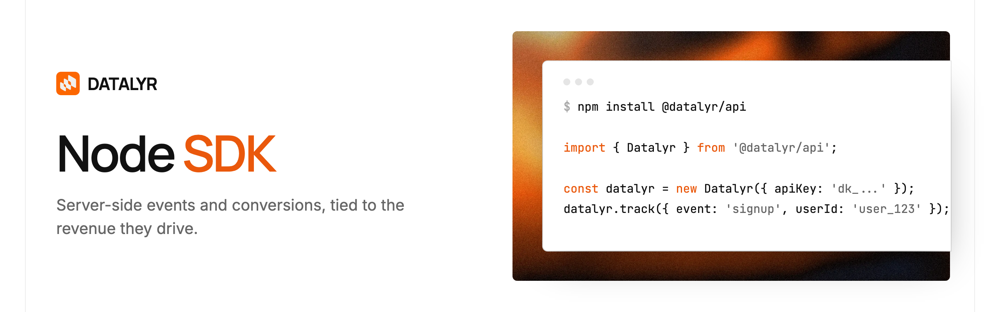

<picture>
  <source media="(prefers-color-scheme: dark)" srcset=".github/assets/banner-dark.png">
  
</picture>

<p align="center">
  <a href="https://www.npmjs.com/package/@datalyr/api"></a>
  <a href="https://github.com/datalyr/api/actions/workflows/ci.yml"></a>
  <a href="LICENSE"></a>
  <a href="https://docs.datalyr.com/sdk-reference/node"></a>
</p>

# DATALYR Node SDK

Send events and revenue from your server to DATALYR and see which channel, campaign and ad drove every conversion.

- **Server-side truth.** Signups, purchases and webhooks are recorded where they happen, so ad blockers cannot hide them.
- **One customer, every touch.** Server events join the same person your website and app track.
- **No double counting.** Pass a webhook's own event ID and redeliveries count once.
- **Safe in production.** The SDK never throws on a bad event, retries failed sends and drains its queue on shutdown.

## Install

The SDK needs Node 18 or later.

```bash
npm install @datalyr/api
```

Find your server API key in DATALYR under **Settings → API**. The key starts with `dk_`.

## Quick start

```javascript
import { Datalyr } from '@datalyr/api';

const datalyr = new Datalyr({ apiKey: process.env.DATALYR_API_KEY });

// Track an action
await datalyr.track({
  event: 'signup_completed',
  userId: 'user_123',
  properties: { plan: 'pro' },
});

// Attach traits to your user
await datalyr.identify('user_123', { email: 'user@example.com' });

// Record a conversion with its value
await datalyr.trackPurchase('user_123', { value: 49.0, currency: 'USD' });

// Before the process exits, send all queued events
await datalyr.close();
```

Keep the API key on your server. Do not put it in browser or app code.

## Check it works

1. Run the quick start with your API key.
2. In DATALYR, open **Events**.
3. Confirm that a `signup_completed` event arrives within 30 seconds.

If no event arrives, add `debug: true` to the constructor. Then read the process logs.

## Set up with an AI agent

Your AI agent can install the SDK for you. Connect the agent to the DATALYR MCP server at `https://mcp.datalyr.com/mcp`. Then ask it to install server-side tracking. See [DATALYR MCP](https://docs.datalyr.com/datalyr-mcp).

## Documentation

- [Node SDK reference](https://docs.datalyr.com/sdk-reference/node): every method, option and event
- [Examples](examples/): Express, Stripe webhooks and a basic script
- [Changelog](CHANGELOG.md)
- Other SDKs: [Web](https://github.com/datalyr/web) · [React Native](https://github.com/datalyr/react-native) · [iOS (Swift)](https://github.com/datalyr/swift)

## Support

- Bugs and feature requests: [open an issue](https://github.com/datalyr/api/issues/new/choose)
- Security reports: see [SECURITY.md](SECURITY.md)
- Other questions: [datalyr.com](https://datalyr.com)

## License

MIT. See [LICENSE](LICENSE).
